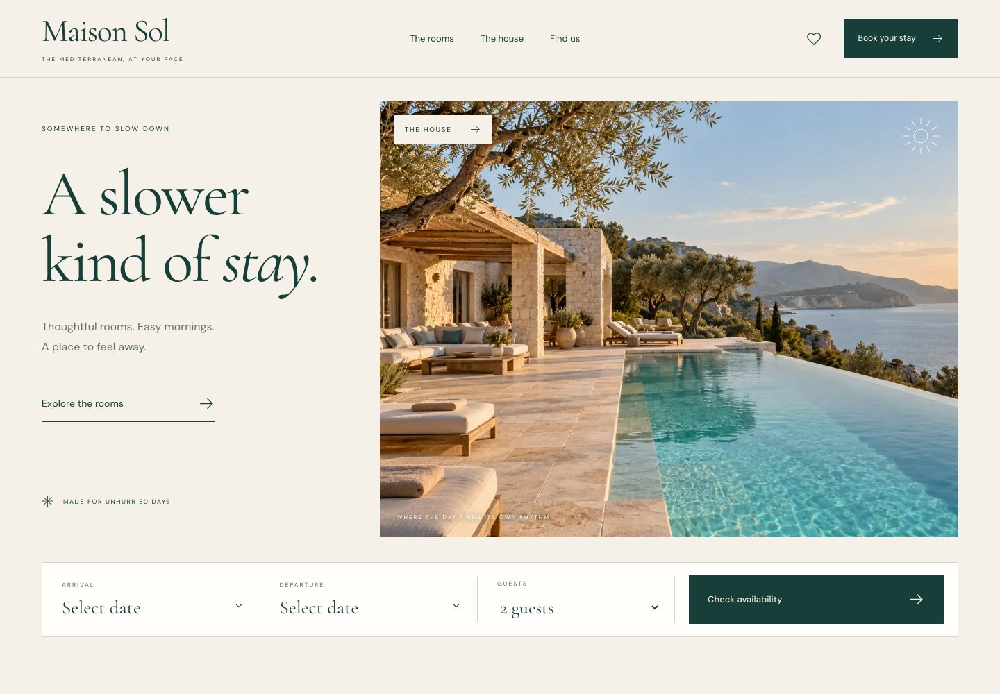

# Maison Sol

A slower kind of stay. An original Mediterranean hotel experience with generous photography, thoughtful room discovery and a complete simulated booking journey.



Built in November 2026 as a fictional-brand portfolio application. All rooms, availability and prices are sample content. No real booking, payment or email is made.

## Explore

- Four distinct rooms with original photography, amenities, guest capacity and sample prices.
- URL-based filtering and sorting, saved rooms, empty results and reset controls.
- Direct room links, an accessible gallery and mobile navigation.
- Date-range calendar, room availability, contact validation, exact stay totals and a local confirmation.
- Recoverable stay preferences; contact details are never persisted or transmitted.
- Subtle motion with reduced-motion support and locally bundled imagery/fonts.

Live demo: publication verification pending. The verified URL will be added after deployment.

## Run locally

Node **22.23.1** and npm **10.9.8**.

```sh
npm ci
npm run dev
```

Open the printed local URL, including `/maison-sol-react/`. Hash-based routes also work on static hosting.

## Verify

```sh
npm run lint
npm run format:check
npm run typecheck
npm test
npm run build
npx playwright install chromium webkit
npm run test:e2e
```

To inspect the built output, use `npm run preview`. Browser tests use the production build and deterministic dates. `npm run format` formats source; `npm run test:watch` runs unit tests during development.

For a deployed build, set `DEMO_URL` to its verified absolute URL (with trailing slash) before `npm run test:e2e`.

## Try the demo

Choose dates and a room, then use **Use sample details** on the details step. Acknowledgement and review lead to a simulated confirmation. Footer **Reset my stay & saved rooms** clears only this application's local preferences. Contact details disappear when leaving the booking page or reloading.

See [architecture and tradeoffs](docs/ARCHITECTURE.md), [verification](docs/VERIFICATION.md), [asset provenance](ASSETS.md) and [the implementation plan](IMPLEMENTATION_PLAN.md). Source code is MIT; bundled fonts have their own OFL notices.
