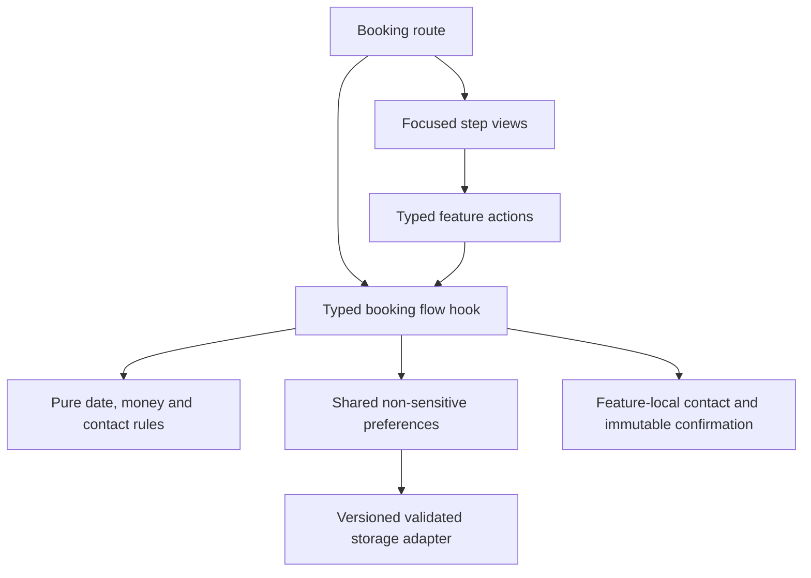

# Architecture and design decisions

Maison Sol is an original fictional hotel application, created in November 2026. The browser is the only runtime: no server, account, payment provider, analytics or external image/font requests are required.

- **UI:** React 19, React Router 8 and Vite 8, strict TypeScript 6 and plain CSS. TypeScript 6 is the supported parser baseline for the current TypeScript ESLint integration; installing TypeScript 7 caused a real compatibility error during setup. Exact versions are in the lockfile.
- **Routes:** hash navigation makes direct room/bookmark URLs work on GitHub Pages without an HTTP rewrite service. Vite's explicit repository base prefixes assets. Unknown application routes and non-application HTTP paths have deliberate not-found pages.
- **State:** the provider owns stay preferences and saved IDs. Domain calculations have no browser or React dependencies. Contact fields exist only in the mounted booking component. A completed stay captures an immutable snapshot, so resetting preferences cannot revive a confirmation against different dates.
- **Dates:** valid ISO date-only strings; UTC midnight differences avoid daylight-saving arithmetic errors. The clock supplies the visitor's local calendar date. Availability checks every occupied night in [arrival, departure), allowing checkout on an occupied night. Each room has deterministic monthly unavailable fixtures. Stays are limited to 30 nights.
- **Money:** integer euro cents. A sample 10% service fee is rounded once; sample local tax is €3 per guest per night. Prices and fees are illustrative and no charge is made.
- **Persistence:** a versioned, size-limited allowlist accepts only known room IDs, dates and guest counts. Invalid JSON, unknown versions, unavailable storage and denied writes leave the app usable. No guest names, email, arbitrary fields or confirmation records enter storage.
- **Interaction:** native dialog handles trapping, Escape and focus restoration; semantic controls support keyboard input. The calendar has explicit non-submit buttons. Mobile menu, gallery and booking headings are verified with focus assertions. Motion is optional and respects `prefers-reduced-motion`.
- **Art direction:** warm ivory and deep teal, Cormorant Garamond and DM Sans, asymmetric editorial room previews and original Mediterranean imagery. Responsive WebP sources are local. Reference mockups were composition targets, not embedded pages.
- **Deployment:** GitHub Actions runs lint, formatting, strict typing, unit tests, production build and three browser projects. Only a successful main-branch run can deploy; PR verification has read-only contents permission. Action references are official repository commits, not mutable tags.

## Meaningful limits

This frontend demonstrates booking UX, not a real hotel inventory system. Local fixtures have no concurrency or server-side authority. There is no payment, email, authentication, backend or real property address. Contact fields are explicitly presented as a simulation. Refresh recovers dates/saved rooms, not personal details or a completed booking.

Automated accessibility scans and keyboard checks are evidence for the tested routes, not WCAG certification or a replacement for assistive-technology review. Browser testing covers current Chromium and WebKit; Firefox and physical-device screen readers were not tested.

The initial dependency audit reported a minimatch glob amplification advisory in development-only ESLint dependencies. Production dependency audit is recorded separately in verification. No forced major transitive override is used to obtain a clean audit; upstream tool updates should be reviewed before refreshing the lockfile.

## Booking feature boundaries

`pages/Booking.tsx` composes the route heading, step navigation and feature views. `features/booking/useBookingFlow.ts` owns this mounted journey's transient step, contact, errors and confirmation, exposing typed actions instead of raw setters. It derives availability and totals once from source draft state through pure domain rules. Contact validation lives in `domain/contact.ts`; it has no React, DOM or storage dependency.

The dates, room selection, details and review views each render their own responsibility. The route owns heading focus; the details view owns its form ref and invalid-field focus. Summary and confirmation render supplied values, without calculating prices or accessing storage. The immutable confirmation snapshot is a feature type.

Only the existing preferences provider owns genuinely shared dates/guest/room and saved-room identifiers. It reaches the versioned persistence adapter; feature views and pure domain rules never read browser storage. Contact inputs remain feature-local so they survive backward edits within the journey but disappear on route unmount/reload. Dialog open state remains local to its UI.

The bounded extraction preserved the semantic DOM, styles and interaction copy. Regression coverage includes review edits and recalculated totals, contact retention between steps, contact clearing after route remount, reset behavior and immutable confirmation.
